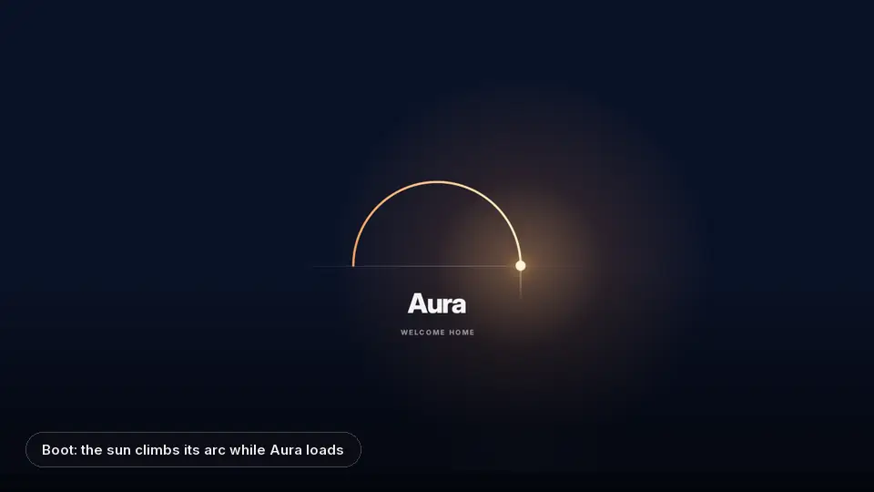
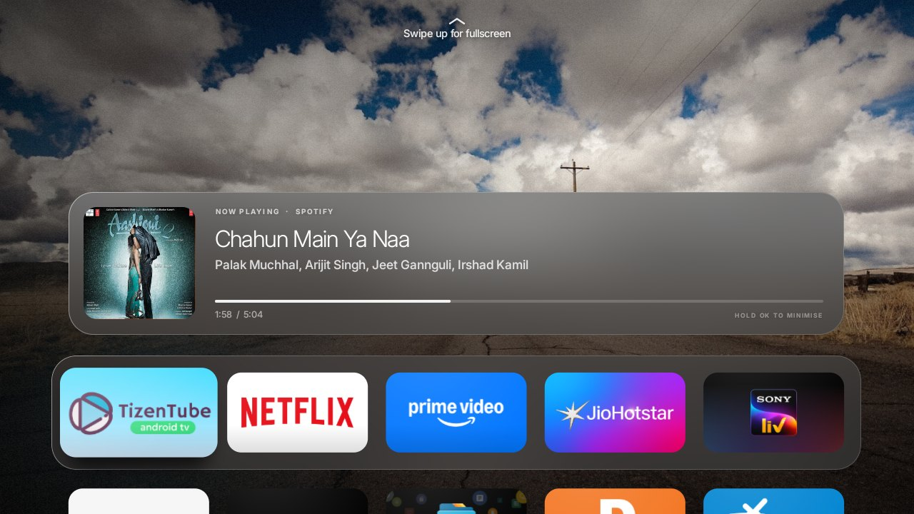
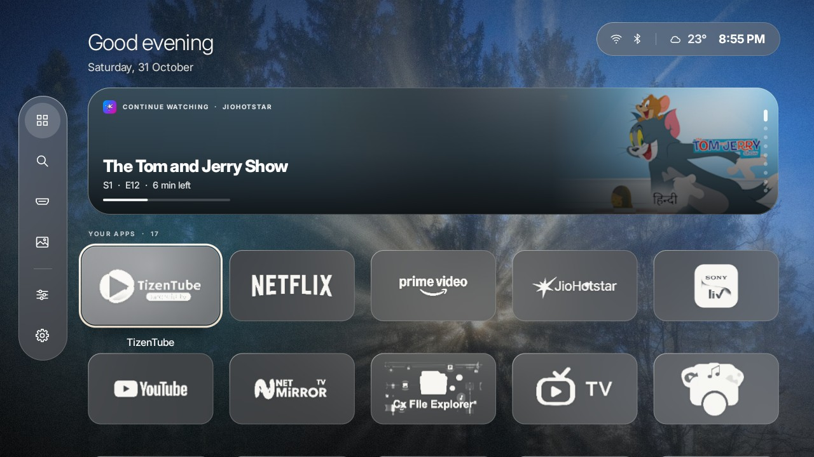
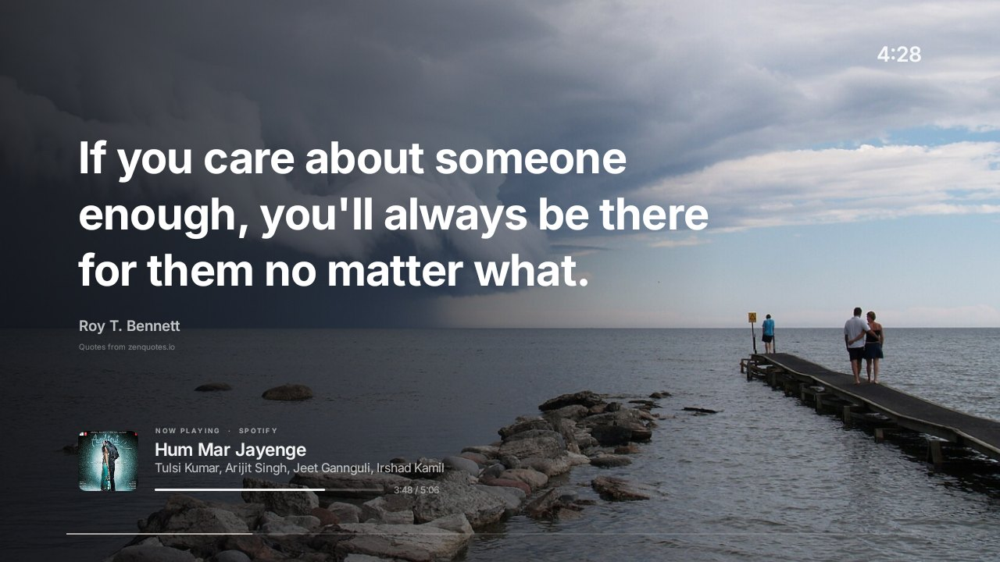
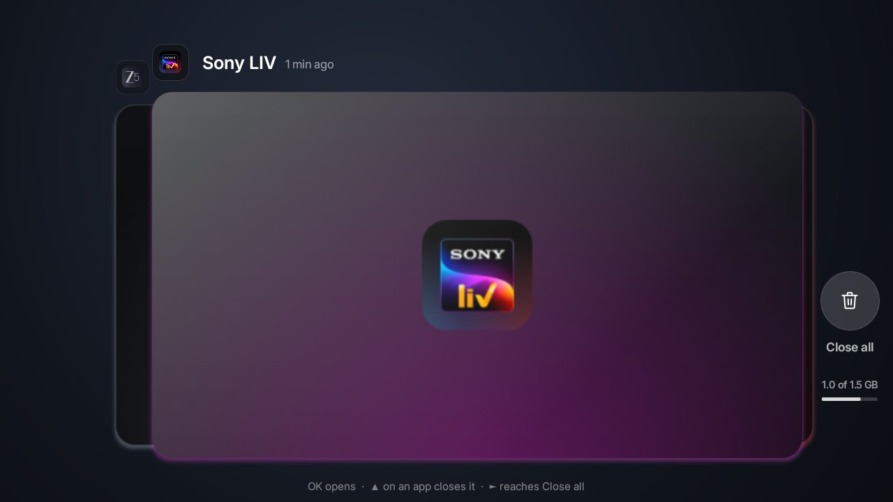
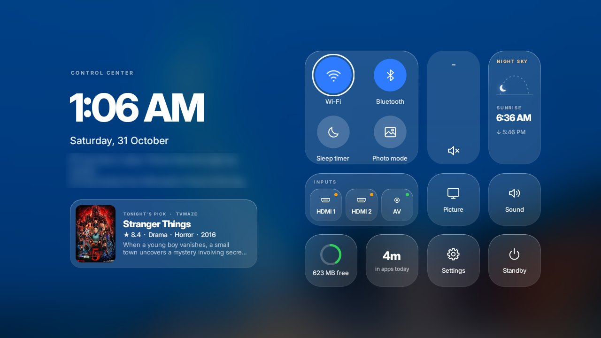
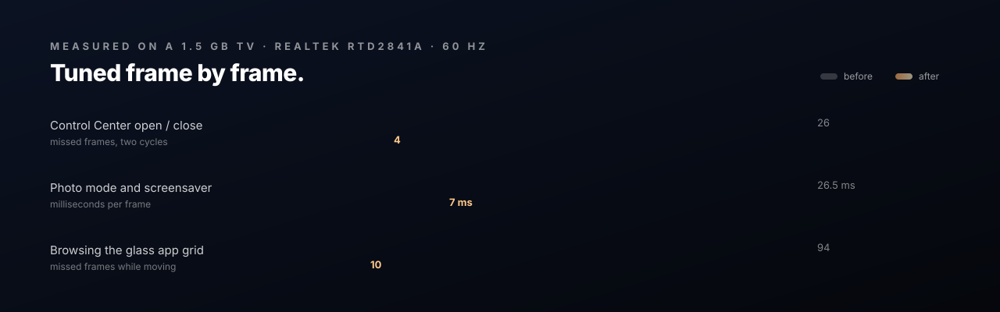

<p align="center">
  
</p>

<p align="center">
  <b>A calmer home screen for Android TV.</b><br>
  <sub>Your apps on frosted glass over living photographs · music that takes the screen gently · no ads, no account</sub>
</p>

<p align="center">
  
  
  
  
</p>

<p align="center">
  
</p>

<p align="center">
  <a href="#install"><b>Install</b></a> &nbsp;·&nbsp;
  <a href="#new-in-76"><b>New in 7.6</b></a> &nbsp;·&nbsp;
  <a href="#a-quiet-tour"><b>Tour</b></a> &nbsp;·&nbsp;
  <a href="#the-remote"><b>Remote</b></a> &nbsp;·&nbsp;
  <a href="#help"><b>Help</b></a> &nbsp;·&nbsp;
  <a href="../../releases/latest"><b>Download</b></a>
</p>

<p align="center"><sub>Downloader code</sub><br><b>4172997</b></p>

<br>

## Install

Everything happens on the TV, with the remote. No computer, no account.

1. **Get Downloader** from the Play Store on your TV (by AFTVnews, free).
2. **Type `4172997`** and press *Go*. It always fetches the newest Aura. If the code doesn't load, type the address instead:
   ```
   github.com/cookedzera/aura-tv/releases/latest/download/Aura.apk
   ```
3. **Allow and install.** Android asks once to let Downloader install apps: switch it on, press <kbd>Back</kbd>, then *Install*. If Play Protect warns, choose *Install anyway*.
4. **Open Aura.** A short welcome lets you pick a look and your extras, then makes Aura your home.

On **Google TV** and **Fire TV** the TV keeps the Home button for its own launcher, so the welcome adds one more step: **On this TV** walks you through switching on USB debugging, then Aura sets everything up by itself. It can also switch Google TV's own home screen off for you, if you like: nothing is deleted, and it comes back from Settings any time.

Updates arrive in *Settings → Updates*. To leave, use *Settings → Remove Aura*: it hands everything back to the TV first, then Android uninstalls it.

<sub>Android TV 5.1 or newer. A few extras need newer Android (Top Shelf and Continue watching 8.0, Block ads 9.0, pictures in recent apps 11); on older TVs they simply don't appear.</sub>

<br>

## New in 7.6

<p align="center"></p>

- **Music, front and centre.** While a song plays in Spotify, YouTube Music or any music app, one calm card with its cover takes the place of the widgets. <kbd>OK</kbd> opens a full-screen Now Playing in the album's own colours; hold <kbd>OK</kbd> to minimise it. Leave the remote for ten seconds and the music becomes the screen.
- **Who's watching.** A quiet profile picker, on the remote's Profile button and in Settings.
- **Settings that explain themselves.** Grouped into sections, with one plain sentence for whichever row you're on.
- **Only apps.** One switch for the simplest home: your apps on the photograph, nothing else.
- **Search, folders, your own tile art,** and your whole setup saved to your phone.
- **Smoother:** Continue watching loads faster, start-up arrives in order, and the screensaver uses less memory.

<sub>Updating from 7.5? Run *Settings → Set up on this TV → Switch everything on* once, so the Profile button can open Aura's picker.</sub>

<br>

## A quiet tour

### The home screen

<p align="center"></p>

Your apps as glass tiles over a photograph that follows the real sun: night skies after dark, golden light at dusk, and fresh 4K photographs every day, never the same one twice. Two styles: **Aura**, with a sidebar and widgets, or **tvOS**, your apps alone on a dock.

- **Widgets:** the Sky (the sun's arc, the weather), the Smart Stack (what you're partway through, new episodes, tonight's pick) and Today (time in apps, memory).
- **App cards:** rest on an app and what you were watching in it lines up above it. <kbd>↑</kbd> walks in, <kbd>OK</kbd> plays.
- Hold <kbd>OK</kbd> on any app to move it, hide it, put it in a folder, change its picture or uninstall it.

### Music

<p align="center"></p>

Music never fights for space. While a song plays, the widgets and app cards step aside for one card with its cover; the full screen takes the album's colours, and its controls fade away while you listen. When the TV rests, the screensaver keeps its quotes and photographs, with the song in a small player beneath the words. Control Center shows it too.

### Recent apps

<p align="center"></p>

Press <kbd>Home</kbd> twice: the app you're in stands large, showing its last screen, with older ones behind it. <kbd>▲</kbd> closes one, *Close all* clears them and shows the memory you got back.

### Control Center

<p align="center"></p>

Press <kbd>Menu</kbd>: Wi-Fi with a speed test, Bluetooth, a sleep timer that fades the sound out (or waits for the end of what you're watching), your HDMI inputs by name, picture, sound, memory and standby.

### The screensaver

Photographs drifting slowly, each with its place and who took it, or **famous quotes** over them, lighting line by line the way Apple Music shows lyrics. **Auto** moves between the two. Choose it, preview it and set when it starts in *Settings → Wallpaper*.

### Small things

| | |
|---|---|
| **Block ads** | Stops ad and tracker servers in every app at once, through Android's own Private DNS. |
| **From your phone** | Scan a code to send photos, GIFs or apps to the TV, or type on your phone's keyboard. |
| **Profiles** | Everyone keeps their own apps, folders, tiles and widgets. A kids' profile asks for a PIN for grown-up things. |
| **Tonight's pick** | A film or show worth your evening, by genre and rating, or straight from your TMDB watchlist. |
| **Remote buttons** | Give a spare button on the remote an app to open. |
| **Light mode** | On slower TVs Aura stops moving for nothing. Auto, or your choice. |
| **Always comes back** | If Aura ever keeps crashing, it restarts with its extras off, and hands Home back if it must. |

<br>

## The remote

| Press | On the home screen |
|---|---|
| <kbd>OK</kbd> · hold <kbd>OK</kbd> | Open · move, hide, folder, picture, uninstall |
| <kbd>Home</kbd> twice | Recent apps |
| <kbd>Menu</kbd> | Control Center |
| <kbd>Profile</kbd> | Who's watching |
| <kbd>Back</kbd> | Close whatever is open |

| Press | Inside an app (once set up) |
|---|---|
| <kbd>Home</kbd> twice | Recent apps, over the app |
| hold <kbd>Home</kbd> | Control Center, over the app |

<br>

## Help

<details>
<summary><b>Home still opens the old launcher</b></summary>
<br>

Open Aura → *Settings → Home button*. On Google TV and Fire TV, which keep Home for their own launcher, *Settings → Set up on this TV → Switch everything on* lets Aura answer Home from every app and after a restart. If Android shows the switch greyed out as a *restricted setting* (Android 13+), the same step lifts it.

Any accessibility service, Aura's included, makes a few apps keep their player controls on screen a little longer.
</details>

<details>
<summary><b>The Profile button opens Google's screen</b></summary>
<br>

Some TVs' own software takes the Profile button before any app sees it. Run *Settings → Set up on this TV → Switch everything on* once, then restart the TV: Aura's *Who's watching* takes over. Switching Google TV's own home off (from the same page) hides Google's screen completely.
</details>

<details>
<summary><b>No shows above Netflix or Prime Video</b></summary>
<br>

App cards show what each app shares with Android TV. Netflix and Prime Video share their rows only with Google's own launcher, so elsewhere they stay empty. JioHotstar, YouTube and many others share theirs.
</details>

<details>
<summary><b>A black screen with sound from an HDMI tile</b></summary>
<br>

Live pictures of inputs are off by default because some TVs draw them over the whole screen. Hold <kbd>OK</kbd> on the tile → *Hide from home*; *Settings → Hidden apps* brings it back.
</details>

<details>
<summary><b>What does Aura do with my data?</b></summary>
<br>

Nothing leaves the TV except what each feature fetches: your approximate city (GeoJS, unless you type one) and the weather (Open-Meteo), photographs (Windows Spotlight, Bing, the Bing Wallpaper Archive, plus Wikimedia Commons, Wallhaven or Unsplash if you switch them on), quotes (ZenQuotes, DummyJSON), tonight's pick (TVmaze, or TMDB with your own key), the speed test (Cloudflare) and updates (GitHub). Pictures of your apps for recent apps stay in Aura's private storage for two days at most. To catch the Profile button, Aura reads one line of the TV's own log, on the TV. No analytics, no account.
</details>

<br>

## For tinkerers

<details>
<summary><b>Set up from a PC instead</b></summary>
<br>

Turn on *Developer options* and *network debugging* on the TV, then on a Windows PC with `adb`:

```powershell
$env:AURA_TV = "192.168.1.50:5555"
.\tools\backup.ps1        # a snapshot first: everything can be put back from it
.\tools\setup-aura.ps1    # makes Aura home and grants what the extras need
```

`.\tools\restore.ps1 -RemoveAura` puts the TV back exactly as the snapshot recorded it. `tune.ps1` limits background apps (`-Undo` reverts); `debloat.ps1` is a reviewed disable list for the Acer DIX41RKF: read it before using it elsewhere.
</details>

<details>
<summary><b>Build it</b></summary>
<br>

No Gradle: `.\tools\build.ps1` drives aapt2, javac, d8, zipalign and apksigner from the Android SDK (Android Studio's JDK is fine). `-TestPackage` builds a copy under another package name, to test a first install beside the real one.

Plain Java on the Android framework, no AndroidX. Tuned on an Acer DIX41RKF: Realtek RTD2841, Android 11, 1.5&nbsp;GB of RAM.
</details>

<details>
<summary><b>How the glass stays smooth</b></summary>
<br>

<p align="center"></p>

The photograph is blurred once, when it arrives, into a tiny copy that every pane samples: one draw per pane. Panels slide rather than scale text, nothing under an opaque overlay keeps drawing, and still screens draw nothing at all.

<p align="center"></p>
</details>

<br>

## Credits

Photographs from Windows Spotlight and Bing, the older ones through the
[Bing Wallpaper Archive](https://github.com/npanuhin/Bing-Wallpaper-Archive); they belong to their
photographers, each credited on screen. Quotes: [ZenQuotes](https://zenquotes.io) and
[DummyJSON](https://dummyjson.com), with public-domain words bundled for when the TV is offline.
Tonight's pick: [TVmaze](https://www.tvmaze.com) (CC BY-SA); with your own key,
[TMDB](https://www.themoviedb.org). This product uses the TMDB API but is not endorsed or certified by TMDB.
Weather by [Open-Meteo](https://open-meteo.com) (CC BY 4.0). Type: [Inter](https://rsms.me/inter/) by Rasmus Andersson, SIL Open Font License.

## License

The code is [MIT](LICENSE) © 2026 iravi. The photographs and the typeface keep their own licences.
