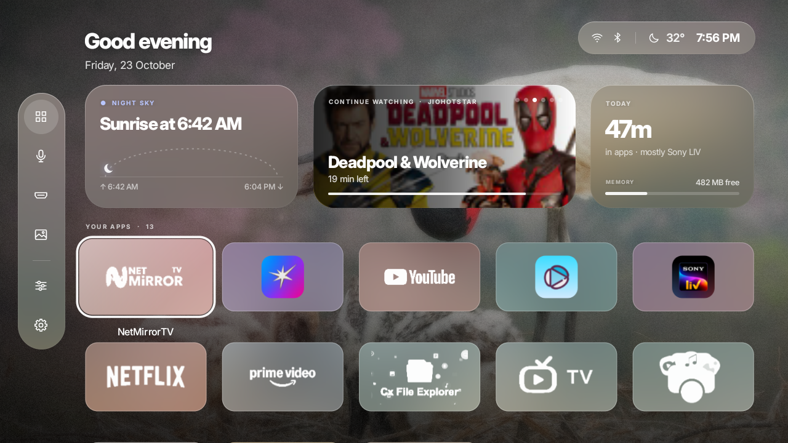
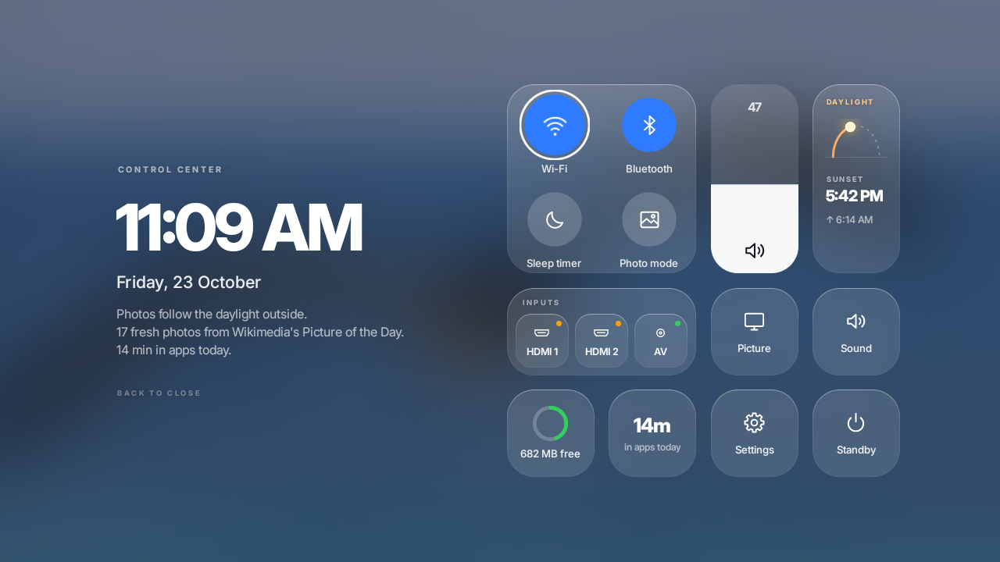
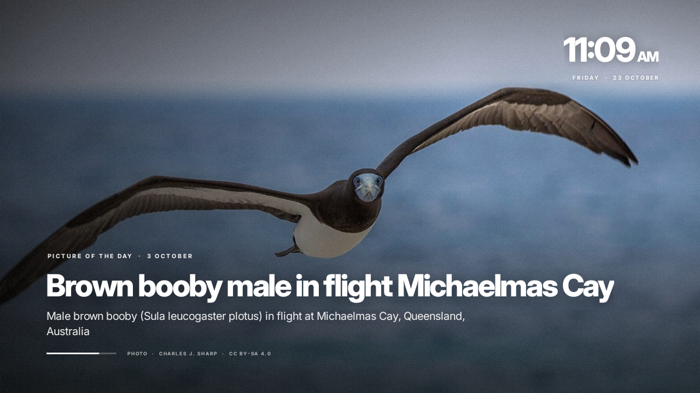

<p align="center">
  
</p>

<p align="center">
  <b>Your TV's home screen, rebuilt as frosted glass over living photographs.</b><br>
  <sub>No ads · no sponsored rows · no account · a steady 60&nbsp;fps on a 1.5&nbsp;GB TV</sub>
</p>

<p align="center">
  
  
  
  
</p>

<p align="center">
  
</p>

<br>

> **Aura** replaces the stock Android TV launcher with something calmer: a glass sidebar, three
> quiet widgets, your apps as frosted tiles, and a photograph that drifts behind it all and follows
> the real sun outside. Every pixel of it was tuned on a budget 1.5&nbsp;GB TV, frame by frame.

<br>

## ✦ 01 &nbsp;·&nbsp; The home screen

<table>
<tr>
<td width="58%"></td>
<td>

**Glass tiles.** Each app's logo is lifted off its own banner and set as a white mark on glass
tinted in the app's colour. Logos that can't be lifted keep their icon, on glass.

**A Smart Stack.** Full-bleed cards that change on their own: every show you're partway through
(from Android TV's *Continue Watching* list, with the time left), the app you usually open at this
hour, what you opened last, and what you've watched most today. It holds still while you look at it.

**Sky and Today.** *Sky* draws the sun on its arc with the next sunset, for your city. *Today* shows
time in apps and free memory, and turns into **Now Playing** (OK plays or pauses) while something plays.

**Live previews.** Rest on a switched-on HDMI source and its picture appears inside the tile, muted.

**Weather** sits next to the clock, and a soft light in the focused app's colour follows you around.

</td>
</tr>
</table>

## ✦ 02 &nbsp;·&nbsp; Glass that doesn't cost frames

<p align="center"></p>

Real frosted glass usually means blurring the screen behind every panel, every frame. Aura blurs the
photograph **once**, when it arrives, into a tiny 128&times;72 copy. Every pane samples its own slice of
that copy, and the pane's tint, frost and highlight are folded into a single colour matrix. One
rounded draw per pane, whether it's a tile, a widget, the sidebar or Control Center.

## ✦ 03 &nbsp;·&nbsp; Control Center

<table>
<tr>
<td>

Press <kbd>Menu</kbd>. A frosted board rises with the time set large beside it: round toggles for
Wi-Fi, Bluetooth, the sleep timer and photo mode, a tall volume slider, your HDMI inputs, picture
and sound settings, a memory boost and standby.

**Wi-Fi** opens as a sheet: on/off, disconnect, nearby networks with a password field.
**Tonight's pick** puts a top-rated show beside the clock (from TVmaze); OK finds its trailer.
**Gentle Sleep** fades the volume over the timer's last minute, then puts the TV to standby.
**Live Inputs** turns a set-top box or console that just switched on into the first tile.
**Settings**, from the sidebar: glass or original tiles, app names, hidden apps, the stack,
weather city, and switches for every extra.

</td>
<td width="58%"></td>
</tr>
</table>

## ✦ 04 &nbsp;·&nbsp; A new photograph every day

<table>
<tr>
<td width="58%"></td>
<td>

Aura ships with 23 hand-picked landscapes and adds **Wikimedia Commons' Picture of the Day** in the
background: wide, high-resolution, properly licensed, no account and no API key. Each one arrives
with its title, a line about it, the photographer and the licence.

**Sky Sync** matches the built-in photographs to the light outside, for your city: night skies after
dark, golden hour at dusk. When the light turns (first light, sunrise, golden hour, sunset) a small
**sky moment** card slides in and the photograph changes with it.

Leave the TV for a while and the photograph sharpens into **photo mode**; the screensaver uses the
same story card, with the time and the weather.

</td>
</tr>
</table>

## ✦ 05 &nbsp;·&nbsp; Measured, not guessed

<p align="center"></p>

<details>
<summary><b>What made the difference</b></summary>
<br>

| Trap | What Aura does instead |
|---|---|
| Blurring behind every panel | One blurred copy per photograph, sampled by every pane |
| Fades painted into offscreen layers | Containers fade by applying alpha straight to their draws |
| Animating the *scale* of text | Panels slide and fade; text is never re-rasterised mid-animation |
| Text shadows over photographs | Gradient shades the GPU paints for free |
| Drawing what an overlay covers | Everything under Control Center stops drawing once the frost is opaque |
| Looping idle animations | The photograph redraws at a third of the frame rate when nothing moves |
| System lookups on the first frame | Readings are kept warm while the home screen idles |

</details>

<br>

## ✦ 06 &nbsp;·&nbsp; Remote

| | |
|---|---|
| <kbd>↑</kbd> <kbd>↓</kbd> <kbd>←</kbd> <kbd>→</kbd> | Move through your apps · up from the top row reaches the widgets · left reaches the sidebar |
| <kbd>OK</kbd> | Open |
| hold <kbd>OK</kbd> | Rearrange: the arrows carry the app, <kbd>OK</kbd> saves |
| <kbd>Back</kbd> | From lower rows, jump to the top · from the sidebar, return to the apps |
| <kbd>Menu</kbd> | Control Center |

<br>

## ✦ 07 &nbsp;·&nbsp; Install in four steps

You need a Windows PC on the same network as the TV, the Android SDK platform-tools (`adb`), and to
build from source the Android SDK build-tools plus a JDK 11+ (Android Studio brings both).

**1 &nbsp;·&nbsp; Let the PC talk to the TV.** On the TV turn on *Developer options* and *network
debugging*, then note its IP address.

```powershell
$env:AURA_TV = "192.168.1.50:5555"
```

**2 &nbsp;·&nbsp; Take a snapshot first.** Everything Aura changes can be put back from it.

```powershell
.\tools\backup.ps1
```

**3 &nbsp;·&nbsp; Build, or download.** Build straight from the SDK tools (a signing key is made on the
first run), or take `Aura.apk` from [Releases](../../releases/latest) and save it as `launcher/Aura.apk`.

```powershell
.\tools\build.ps1
```

**4 &nbsp;·&nbsp; Make it home.** This also approves what the extras need: usage history (Smart
Stack, Today), the TV listings (Continue Watching), media sessions (Now Playing) and Wi-Fi control.
Add `-NearbyWifi` to list nearby networks too, which turns on location services.

```powershell
.\tools\setup-aura.ps1
```

Changed your mind? `.\tools\restore.ps1 -DryRun` shows every step, and `.\tools\restore.ps1 -RemoveAura`
re-enables every package, restores your settings, hands Home back and uninstalls Aura.

<details>
<summary><b>Optional: speed tuning and debloat</b></summary>
<br>

- `.\tools\tune.ps1` compiles Aura ahead of time and stops five streaming apps running in the
  background while you aren't using them. `-Undo` reverts it.
- `.\tools\debloat.ps1` disables the ads, telemetry and junk packages of an **Acer / Dixon DIX41RKF**
  Google TV with `pm disable-user` (nothing is uninstalled). Read the list and adjust it before using
  it on any other TV.

</details>

<details>
<summary><b>All the scripts</b></summary>
<br>

| Script | Does |
|---|---|
| `backup.ps1` | Saves enabled/disabled packages, all settings and the home app to `backup/` (git-ignored: it's personal). |
| `build.ps1` | aapt2 → javac → d8 → zipalign → apksigner, no Gradle. |
| `setup-aura.ps1` | Installs Aura as home, screensaver and a force-lock-only device admin (for Standby and the sleep timer). |
| `tune.ps1` | Background limits and an ahead-of-time compile. `-Undo` reverts. |
| `debloat.ps1` | The reviewed disable list for the DIX41RKF, one reason per package. |
| `restore.ps1` / `restore.bat` | Puts the TV back exactly as the backup recorded it. |
| `prepare_wallpapers.py` | Fetches, grades and credits the built-in photographs. |
| `make_icons.py` | Draws the line icons, launcher icon, TV banner and social preview. |
| `make_tour.py` | Builds the animated tour at the top of this page from TV screenshots. |

</details>

<details>
<summary><b>Under the hood</b></summary>
<br>

- Plain Java on the Android framework, minSdk 26, about 13&nbsp;MB, almost all of it photographs.
- Remote input is routed by hand: grid maths for the apps, geometry for Control Center. Held keys
  step at a steady pace instead of queueing, and holding <kbd>OK</kbd> is timed from the press, so
  it works with IR remotes that barely repeat.
- Pictures of the Day arrive through a JobScheduler job every six hours on any network, with a
  descriptive User-Agent, spaced requests and back-off when Wikimedia asks. Only wide JPEGs are kept,
  centre-cropped to the TV, the newest 40.
- Tested on an Acer DIX41RKF: Realtek RTD2841A, Android 11, 720p, 1.5&nbsp;GB RAM. Android 11's
  cached-app freezer can't run there (its 4.14 kernel lacks `freezer.killable`).

</details>

<br>

## Credits

Photographs from Wikimedia Commons Featured Pictures and Picture of the Day (CC BY, CC BY-SA, CC0
and public domain), each credited on screen. Type: [Inter](https://rsms.me/inter/) by Rasmus
Andersson, SIL Open Font License (`launcher/src/main/assets/fonts/LICENSE-Inter.txt`).

## License

The code is [MIT](LICENSE) © 2026 iravi. The photographs and the typeface keep their own licences.
