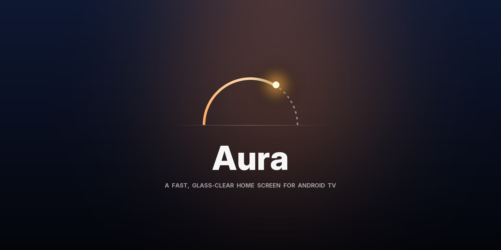

<p align="center"></p>

# Aura

**A fast, glass-clear home screen for Android TV.** Frosted glass over living photographs, a soft
light that follows your focus, and a steady 60 fps on a budget 1.5 GB TV. No ads, no rows of
sponsored content, no account.

<p align="center"></p>

| Control Center | Photo mode & screensaver |
|---|---|
|  |  |

## Highlights

- **Glass, done cheaply.** Every pane (tiles, widgets, sidebar, Control Center) is frosted glass cut
  from one shared, pre-blurred copy of the photograph, with its tint folded into a single colour
  filter: one draw per pane, so it stays smooth on weak TV GPUs.
- **App tiles that match.** Each app's logo is lifted off its own banner as a clean white mark on glass
  tinted in the app's colour. Apps whose banner can't be lifted show their icon on the glass instead.
- **A fresh photograph every day.** Wikimedia Commons' *Picture of the Day* is imported in the
  background (no account, no API key), sized for the TV, and credited on screen with its photographer
  and licence. It joins 23 hand-picked landscapes that ship with the app.
- **Sky Sync.** The built-in photographs follow the real sun, computed offline from your time zone:
  night skies after dark, first light at dawn, golden hour at dusk.
- **Widgets that know you.** *Sky* (the sun on its arc, next sunset), *For You* (your usual app for this
  hour, or "jump back in"), *Today* (time in apps, free memory). Usage history never leaves the TV.
- **Control Center.** Press Menu: Wi-Fi, Bluetooth, sleep timer, photo mode, a tall volume slider,
  HDMI inputs, picture and sound settings, a memory boost and standby, on one frosted board.
- **Live Inputs.** Switch on a set-top box or console and it becomes the first tile, tagged LIVE.
- **Gentle Sleep.** The sleep timer fades the volume over its last minute, then puts the TV in standby.
- **Photo mode and screensaver.** Leave the TV alone and the photograph sharpens; leave it longer and
  it becomes a story card: the place, a line about it, the photographer, and the time.
- **Boot screen.** While Aura loads, the sun climbs the sky arc as the progress bar.

## Remote

| Key | Does |
|---|---|
| Arrows | Move through the apps; up from the top row reaches the widgets, left from the first column the sidebar |
| OK / hold OK | Open / rearrange (the arrows carry the app, OK saves) |
| Back | From lower rows, jump to the top row; from the sidebar, return to the apps |
| Menu or Settings | Control Center |

## Install

You need a Windows PC on the same network as the TV, the Android SDK platform-tools (`adb`) and, to
build from source, the Android SDK build-tools plus a JDK 11+ (Android Studio has both).

1. On the TV, turn on **Developer options** and **USB/network debugging**, and note its IP address.
2. Tell the scripts where the TV is:
   ```powershell
   $env:AURA_TV = "192.168.1.50:5555"
   ```
3. Snapshot the TV before changing anything (this is what `restore` returns it to):
   ```powershell
   .\tools\backup.ps1
   ```
4. Build Aura and set it as the home screen and screensaver:
   ```powershell
   .\tools\build.ps1
   .\tools\setup-aura.ps1
   ```

Optional:
- `.\tools\tune.ps1` gives Aura a full ahead-of-time compile and stops five streaming apps running in
  the background when you aren't using them. `-Undo` reverts it.
- `.\tools\debloat.ps1` disables the ads, telemetry and junk packages of an **Acer / Dixon DIX41RKF**
  Google TV (`pm disable-user`, never uninstall). Read the list and adjust it before using it on
  any other TV.

### Undo everything

```powershell
.\tools\restore.ps1 -DryRun      # shows every command first
.\tools\restore.ps1 -RemoveAura  # re-enables every package, restores settings, hands Home back, uninstalls Aura
```

## Scripts

| Script | Does |
|---|---|
| `backup.ps1` | Saves enabled/disabled packages, all settings and the home app to `backup/` (kept private by `.gitignore`). |
| `build.ps1` | Builds `launcher/Aura.apk` straight from the Android SDK tools (aapt2, javac, d8, apksigner), no Gradle. Creates a signing key on first run. |
| `setup-aura.ps1` | Installs Aura as home, screensaver and a force-lock-only device admin (for Standby and the sleep timer). |
| `tune.ps1` | Background limits and an ahead-of-time compile. `-Undo` reverts. |
| `debloat.ps1` | The reviewed disable list for the DIX41RKF, one reason per package. |
| `restore.ps1` / `restore.bat` | Puts the TV back exactly as the backup recorded it. |
| `prepare_wallpapers.py` | Fetches, grades and credits the built-in photographs. |
| `make_icons.py` | Draws the line icons, launcher icon, TV banner and the social preview. |

## Under the hood

- Plain Java on the Android framework (no AndroidX, no Gradle), minSdk 26. The APK is about 13 MB,
  almost all of it photographs.
- The photograph drifts in a slow Ken Burns move and only redraws at a third of the frame rate
  when nothing else is moving.
- Fades never paint offscreen layers, and focus animations settle instead of looping, so idle
  frames cost about 8 ms on a Realtek RTD2841A.
- Remote input is routed by hand (grid maths for the apps, geometry for Control Center), and held
  keys move at a steady pace instead of queueing.

Tested on an Acer DIX41RKF (Android 11, 720p, 1.5 GB RAM). Android 11's cached-app freezer can't be
used there: its 4.14 kernel lacks `freezer.killable`.

## Credits

- Photographs: Wikimedia Commons Featured Pictures and Picture of the Day (CC BY, CC BY-SA, CC0 and
  public domain), each credited on screen with its photographer and licence.
- Type: [Inter](https://rsms.me/inter/) by Rasmus Andersson, SIL Open Font License
  (`launcher/src/main/assets/fonts/LICENSE-Inter.txt`).
