<p align="center">
  <picture>
    <source media="(prefers-color-scheme: dark)" srcset="docs/day/hello-evening.svg">
    
  </picture>
</p>

<p align="center">
  <b>A calmer home screen for Android TV.</b><br>
  <sub>Your apps on frosted glass over living photographs · music that takes the screen gently · no ads, no account</sub>
</p>

<p align="center">
  <a href="../../releases/latest"></a>
  
  
  
  
</p>

<p align="center">
  <a href="../../releases/latest"><b>Download 7.8</b></a> &nbsp;·&nbsp;
  <a href="#install">Install</a> &nbsp;·&nbsp;
  <a href="#new">What's new</a> &nbsp;·&nbsp;
  <a href="#tour">Tour</a> &nbsp;·&nbsp;
  <a href="#remote">Remote</a> &nbsp;·&nbsp;
  <a href="#help">Help</a>
</p>

<br>

<a name="install"></a>
<p align="center"></p>

Everything happens on the TV, with the remote. No computer, no account.

<p align="center">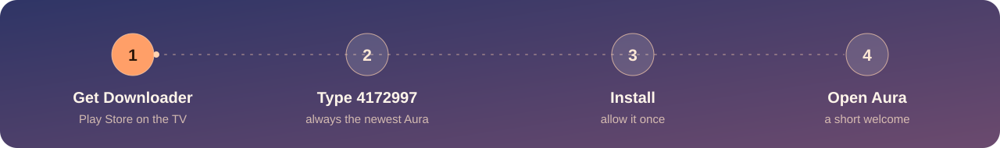</p>

1. **Get Downloader** from the Play Store on your TV (by AFTVnews, free).
2. **Type `4172997`** and press *Go*. It always fetches the newest Aura. If the code doesn't load, type the address instead:
   ```
   github.com/cookedzera/aura-tv/releases/latest/download/Aura.apk
   ```
3. **Allow and install.** Android asks once to let Downloader install apps: switch it on, press <kbd>Back</kbd>, then *Install*. If Play Protect warns, choose *Install anyway*.
4. **Open Aura.** A short welcome lets you pick a look and your extras, then makes Aura your home.

<p align="center">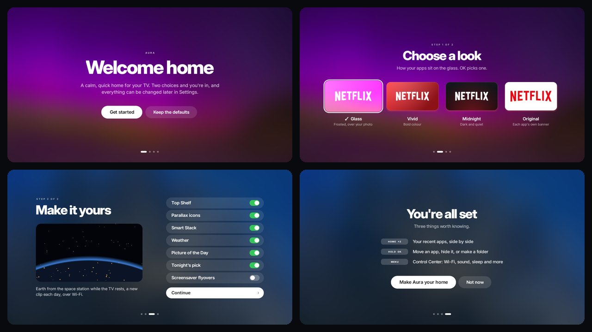</p>

On **Google TV** and **Fire TV** the TV keeps the Home button for its own launcher, so the welcome adds one more step: **On this TV** walks you through switching on USB debugging, then Aura sets everything up by itself. Home opens Aura from then on, with the TV's own home screen left on: on Google TV and Xiaomi TVs, switching it off has left TVs black or stuck restarting, so Aura doesn't offer it there. Switched off by an earlier Aura? *Settings → Set up on this TV* brings it back.

> [!TIP]
> Updating from 7.7? Install over it, or use *Settings → Updates*. Your profiles, tiles and photos stay where they are.

To leave, use *Settings → Remove Aura*: it hands everything back to the TV first, then Android uninstalls it.

<sub>Android TV 5.1 or newer. A few extras need newer Android (Top Shelf and Continue watching 8.0, Block ads 9.0, pictures in recent apps 11); on older TVs they simply don't appear.</sub>

<br>

<a name="new"></a>
<p align="center"></p>

- **Watch** <sup>BETA</sup> finds something for tonight: films and shows by genre, with trailers and where each one streams on the apps you have. Switch it on in *Settings → Home screen → Watch*.
- **All apps:** every app, by category.
- **Control Center:** new glass, and faster to open.
- **Settings:** clearer, on cards.
- **Smoother:** lighter on small TVs, and home does no work while it sits still.
- **Holding Volume** keeps stepping inside apps on more TVs.
- **Fixes** for the Fire TV Stick 4K running out of memory, and shows on cards from apps like Stremio.

<br>

<a name="tour"></a>
<p align="center"></p>

<p align="center">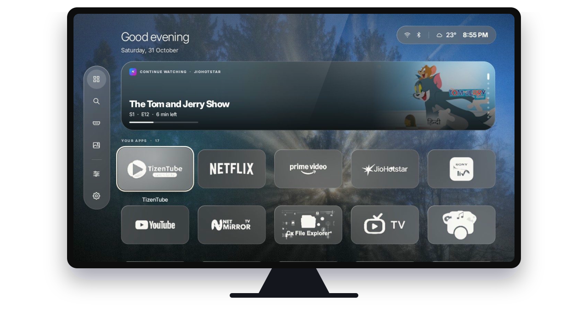</p>

Your apps as glass tiles over a photograph that follows the real sun: night skies after dark, golden light at dusk, and fresh 4K photographs every day, never the same one twice. Two styles: **Aura**, with a sidebar and widgets, or **tvOS**, your apps alone on a dock.

<p align="center">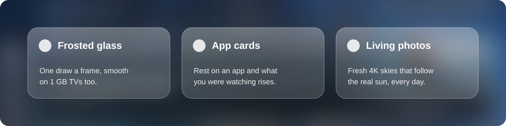</p>

- **Widgets:** the Sky (the sun's arc, the weather), the Smart Stack (what you're partway through, new episodes, tonight's pick) and Today (time in apps, memory).
- **App cards:** rest on an app and what you were watching in it lines up above it. <kbd>↑</kbd> walks in, <kbd>OK</kbd> plays.
- Hold <kbd>OK</kbd> on any app to move it, hide it, put it in a folder, change its picture or uninstall it.

<table>
  <tr>
    <td width="50%">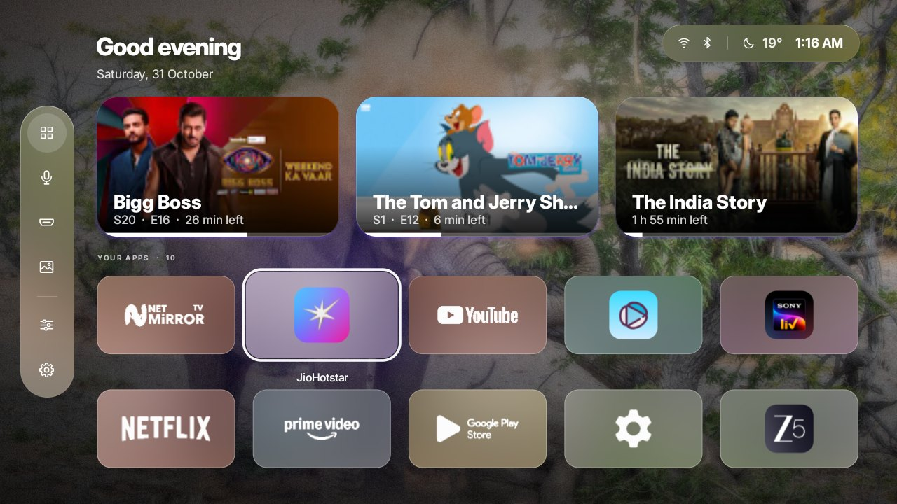<br><b>App cards</b><br><sub>What you were watching, above the app you rest on.</sub></td>
    <td width="50%">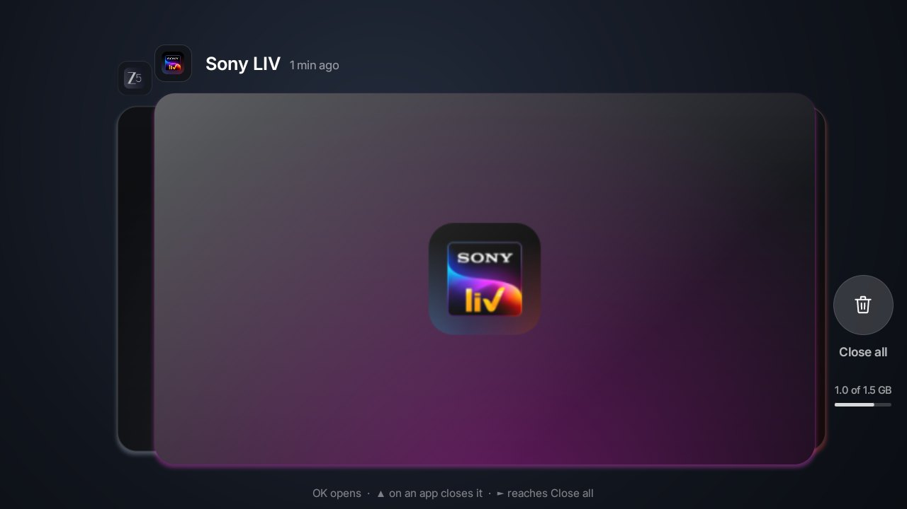<br><b>Recent apps</b><br><sub>Press <kbd>Home</kbd> twice. <kbd>▲</kbd> closes one, <i>Close all</i> shows the memory you got back.</sub></td>
  </tr>
</table>

<p align="center">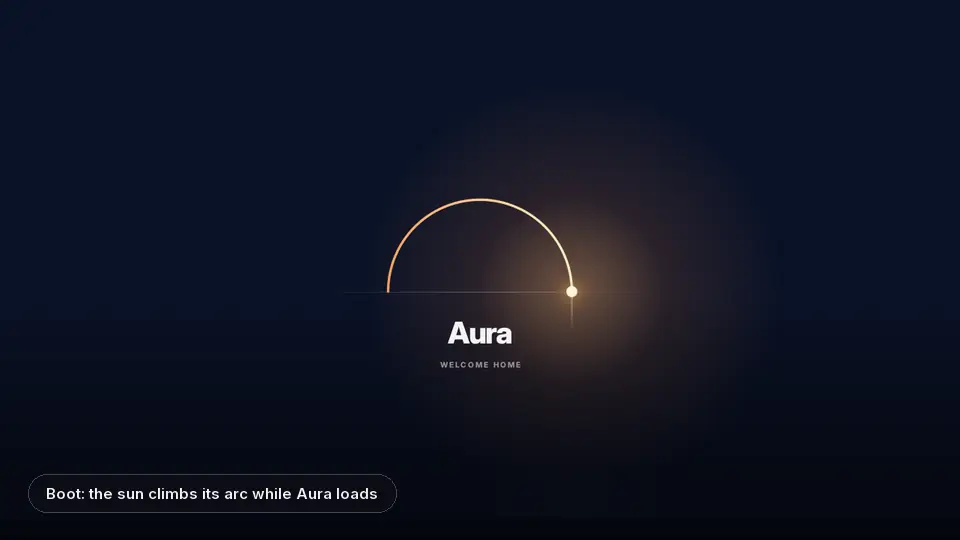</p>

<br>

<p align="center"></p>

<table>
  <tr>
    <td width="50%">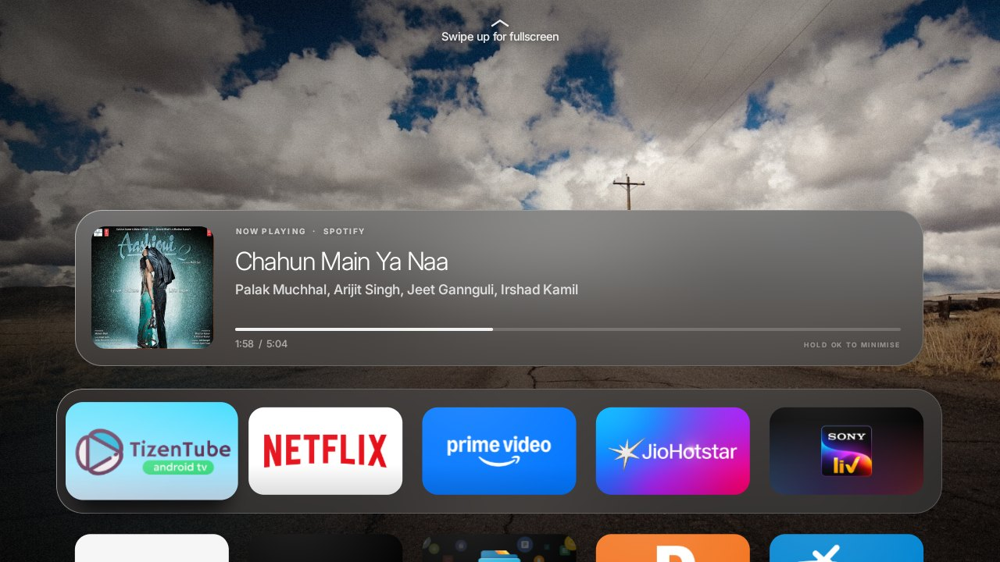<br><b>Now Playing</b><br><sub>A calm card with the cover takes the widgets' place; <kbd>OK</kbd> opens it full screen in the album's colours.</sub></td>
    <td width="50%">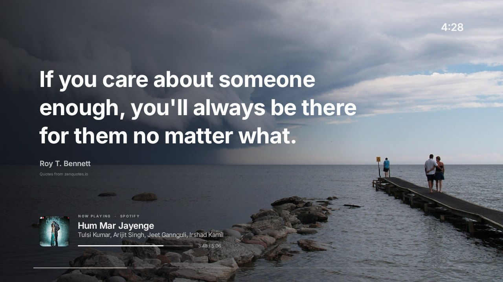<br><b>When the TV rests</b><br><sub>Quotes and photographs, with the song in a small player beneath the words.</sub></td>
  </tr>
</table>

Music never fights for space. While a song plays in Spotify, YouTube Music or any music app, the widgets and app cards step aside, and its controls fade away while you listen. Leave the remote for ten seconds and the music becomes the screen.

**Watch** <sup>BETA</sup> is for the evening: a genre at a time, a large picture of the title in focus, its trailer, and *Open* in the app that has it. Save titles to **My list**, kept per profile on the TV.

<p align="center">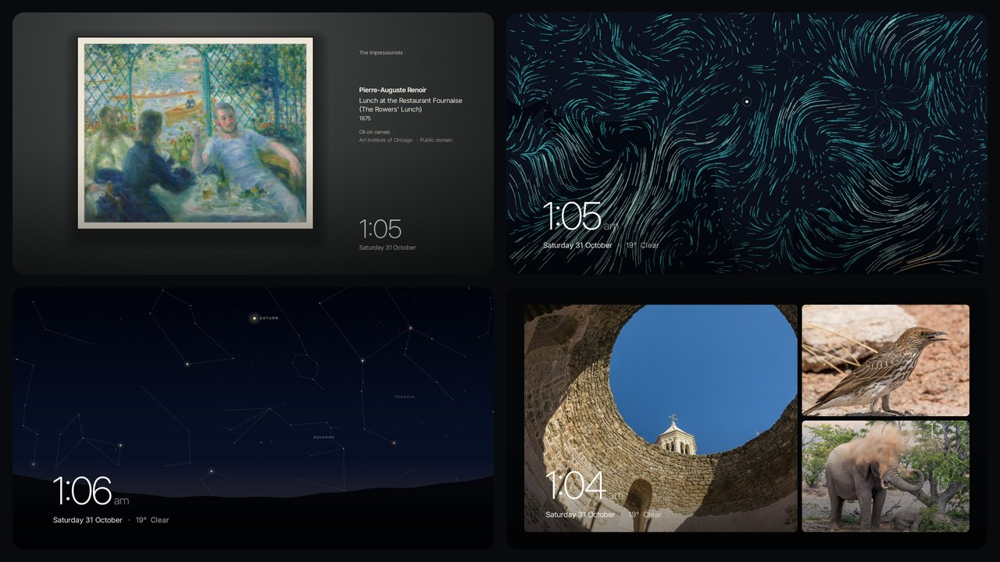</p>

The screensaver: photographs drifting slowly, each with its place and who took it, fine art from the Art Institute of Chicago, live wind currents, the night sky at this hour, or **famous quotes**, lighting line by line the way Apple Music shows lyrics. **Auto** moves between them. Choose it, preview it and set when it starts in *Settings → Wallpaper*.

<br>

<a name="remote"></a>
<p align="center"></p>

<p align="center">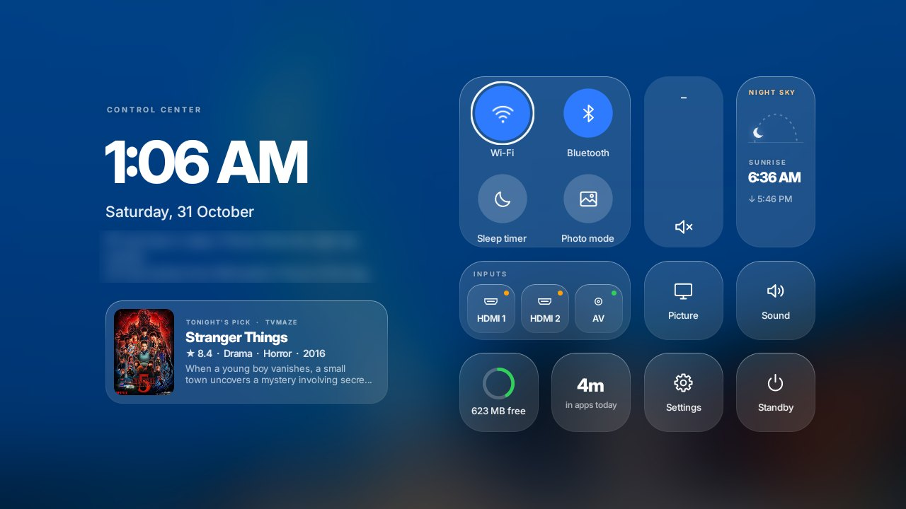</p>

| Press | On the home screen | Inside an app (once set up) |
|---|---|---|
| <kbd>OK</kbd> · hold <kbd>OK</kbd> | Open · move, hide, folder, picture, uninstall | |
| <kbd>Home</kbd> twice | Recent apps | Recent apps, over the app |
| <kbd>Menu</kbd> · hold <kbd>Home</kbd> | Control Center (<kbd>Menu</kbd>) | Control Center, over the app (hold <kbd>Home</kbd>) |
| hold <kbd>Volume</kbd> | | Keeps stepping until you let go |
| <kbd>Profile</kbd> | Who's watching | |
| <kbd>Back</kbd> | Close whatever is open | |

**Control Center** has Wi-Fi with a speed test, Bluetooth, a sleep timer that fades the sound out (or waits for the end of what you're watching), your HDMI inputs by name, picture, sound, memory and standby.

| | |
|---|---|
| **Block ads** | Stops ad and tracker servers in every app at once, through Android's own Private DNS. |
| **From your phone** | Scan a code to send photos, GIFs or apps to the TV, or type on your phone's keyboard. |
| **Play on TV** | Send a video from your phone or computer to the TV (DLNA). |
| **Profiles** | Everyone keeps their own apps, folders, tiles and widgets. A kids' profile asks for a PIN for grown-up things. |
| **Tonight's pick** | A film or show worth your evening, by genre and rating, or straight from your TMDB watchlist. |
| **Remote buttons** | Give a spare button on the remote an app to open. |
| **Light mode** | On slower TVs Aura stops moving for nothing. Auto, or your choice. |
| **Always comes back** | If Aura ever keeps crashing, it restarts with its extras off, and hands Home back if it must. |

<br>

<a name="help"></a>
<p align="center"></p>

<details>
<summary><b>Home still opens the old launcher</b></summary>
<br>

Open Aura → *Settings → Home button*. On Google TV and Fire TV, which keep Home for their own launcher, *Settings → Set up on this TV → Switch everything on* lets Aura answer Home from every app and after a restart. If Android shows the switch greyed out as a *restricted setting* (Android 13+), the same step lifts it.

Any accessibility service, Aura's included, makes a few apps keep their player controls on screen a little longer.
</details>

<details>
<summary><b>The Profile button opens Google's screen</b></summary>
<br>

Some TVs' own software takes the Profile button before any app sees it. Run *Settings → Set up on this TV → Switch everything on* once, then restart the TV: Aura's *Who's watching* takes over.
</details>

<details>
<summary><b>Holding Volume moves only one step in apps</b></summary>
<br>

Run *Settings → Set up on this TV → Switch everything on* once. Aura then hears the remote's own presses and steps the volume for as long as you hold the button.
</details>

<details>
<summary><b>No shows above Netflix or Prime Video</b></summary>
<br>

App cards show what each app shares with Android TV. Netflix and Prime Video share their rows only with Google's own launcher, so elsewhere they stay empty. JioHotstar, YouTube and many others share theirs.
</details>

<details>
<summary><b>A black screen with sound from an HDMI tile</b></summary>
<br>

Live pictures of inputs are off by default because some TVs draw them over the whole screen. Hold <kbd>OK</kbd> on the tile → *Hide from home*; *Settings → Hidden apps* brings it back.
</details>

<details>
<summary><b>What does Aura do with my data?</b></summary>
<br>

Nothing leaves the TV except what each feature fetches: your approximate city (GeoJS) or a city search and the weather (Open-Meteo), photographs (Windows Spotlight, Bing, the Bing Wallpaper Archive, plus Wikimedia Commons, Wallhaven or Unsplash if you switch them on), quotes (ZenQuotes, DummyJSON), aerial screensaver videos (streamed from Apple, nothing saved on the TV), fresh episodes, tonight's pick and Watch (TMDB, using Aura's built-in key or your own, and TVmaze; signing in to a TMDB watchlist is optional), ad-blocking checks (port 853 DNS-over-TLS checks against Control D, AdGuard or Mullvad when you test or set Private DNS), the speed test (Cloudflare) and updates (GitHub).

Watch posters and shelves stay on disk up to a week (and are deleted if Watch is switched off); your My list and pictures of your apps for recent apps stay in Aura's private storage (recent app pictures for two days at most). *Play on TV* makes the TV visible to phones and computers on your home network while it's on. To catch the Profile button and a held Volume button, Aura reads the TV's own log and, on TVs that log nothing, the remote's presses over the TV's own debugging link, all on the TV. No analytics, no account.
</details>

> [!NOTE]
> Watch works out of the box. If you'd rather use your own free TMDB key, add it in *Settings → Tonight's pick → TMDB key*.

<br>

<p align="center"></p>

<details>
<summary><b>Set up from a PC instead</b></summary>
<br>

Turn on *Developer options* and *network debugging* on the TV, then on a Windows PC with `adb`:

```powershell
$env:AURA_TV = "192.168.1.50:5555"
.\tools\backup.ps1        # a snapshot first: everything can be put back from it
.\tools\setup-aura.ps1    # makes Aura home and grants what the extras need
```

`.\tools\restore.ps1 -RemoveAura` puts the TV back exactly as the snapshot recorded it. `tune.ps1` limits background apps (`-Undo` reverts); `debloat.ps1` is a reviewed disable list for the Acer DIX41RKF: read it before using it elsewhere.
</details>

<details>
<summary><b>Build it</b></summary>
<br>

No Gradle: `.\tools\build.ps1` drives aapt2, javac, d8, zipalign and apksigner from the Android SDK (Android Studio's JDK is fine). `-TestPackage` builds a copy under another package name, to test a first install beside the real one.

Plain Java on the Android framework, no AndroidX. Tuned on an Acer DIX41RKF: Realtek RTD2841, Android 11, 1.5&nbsp;GB of RAM.
</details>

<details>
<summary><b>How the glass stays smooth</b></summary>
<br>

<p align="center"></p>

The photograph is blurred once, when it arrives, into a tiny copy that every pane samples: one draw per pane. Panels slide rather than scale text, nothing under an opaque overlay keeps drawing, and still screens draw nothing at all.

<p align="center">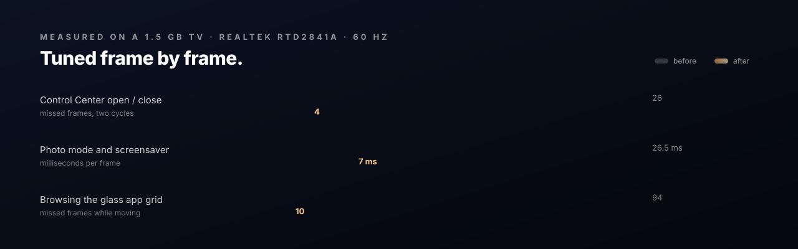</p>
</details>

<details>
<summary><b>Credits</b></summary>
<br>

Photographs from Windows Spotlight and Bing, the older ones through the
[Bing Wallpaper Archive](https://github.com/npanuhin/Bing-Wallpaper-Archive); they belong to their
photographers, each credited on screen. Quotes: [ZenQuotes](https://zenquotes.io) and
[DummyJSON](https://dummyjson.com), with public-domain words bundled for when the TV is offline.
Watch and Tonight's pick: [TMDB](https://www.themoviedb.org), with where to watch from JustWatch through TMDB, and
[TVmaze](https://www.tvmaze.com) (CC BY-SA). This product uses the TMDB API but is not endorsed or certified by TMDB.
Weather by [Open-Meteo](https://open-meteo.com) (CC BY 4.0). Type: [Inter](https://rsms.me/inter/) by Rasmus Andersson, SIL Open Font License.
</details>

<br>

<p align="center"></p>

<p align="center"><sub>The code is <a href="LICENSE">MIT</a> © 2026 iravi. The photographs and the typeface keep their own licences.</sub></p>
