<p align="center">
  
</p>

<p align="center">
  <b>A calmer home screen for Android TV.</b><br>
  <sub>Frosted glass over living photographs · a museum, the real wind and tonight's sky as your screensaver · no ads, no account</sub>
</p>

<p align="center">
  
  
  
  
  
</p>

<p align="center">
  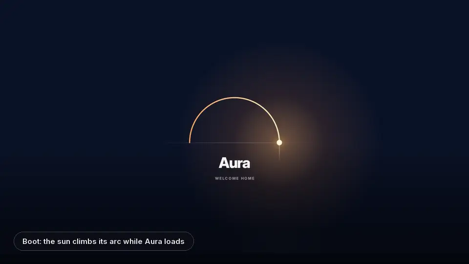
</p>

<p align="center">
  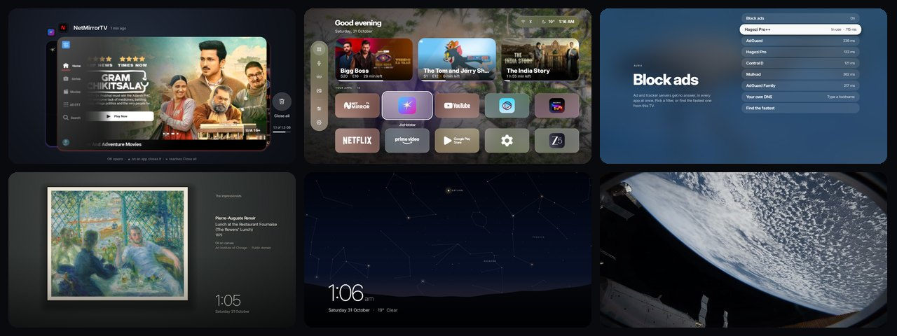
</p>

<p align="center">
  <a href="#-install-in-two-minutes"><b>Install</b></a> &nbsp;·&nbsp;
  <a href="#-whats-inside"><b>What's inside</b></a> &nbsp;·&nbsp;
  <a href="#-the-remote"><b>The remote</b></a> &nbsp;·&nbsp;
  <a href="#-if-something-isnt-right"><b>Help</b></a> &nbsp;·&nbsp;
  <a href="../../releases/latest"><b>Download</b></a>
</p>

<br>

## ⚡ Install in two minutes

Everything happens on the TV with the remote. No computer, no account.

<table>
<tr><td width="44"><h3>1</h3></td><td>

**Get Downloader.** Open the Play Store on the TV, search **Downloader** (by AFTVnews, free) and install it.

</td></tr>
<tr><td><h3>2</h3></td><td>

**Type Aura's address** into Downloader's box and press *Go*:

```
github.com/cookedzera/aura-tv/releases/latest/download/Aura.apk
```

It always points to the newest version.

</td></tr>
<tr><td><h3>3</h3></td><td>

**Allow and install.** The first time, Android asks you to let Downloader install apps: switch it on, press <kbd>Back</kbd>, then *Install*. If Play Protect warns about an unknown app, choose *Install anyway*.

</td></tr>
<tr><td><h3>4</h3></td><td>

**Open Aura.** It's in your apps now. A short welcome asks for a tile look and which extras you'd like, then offers **Make Aura your home**: say yes to Android's question and the Home button opens Aura from then on.

</td></tr>
<tr><td><h3>5</h3></td><td>

**Optional: switch everything on.** In Aura, *Settings → Set up on this TV*. Turn on the TV's *network debugging* (the page links to Developer options), press **Connect**, tick *Always allow* when Android asks, then **Switch everything on**. That's the whole setup that used to need a PC.

</td></tr>
</table>

New versions arrive in *Settings → Updates*. To go back, uninstall Aura from Android's settings and Home returns to the TV's own launcher.

<br>

## ✦ What's inside

### Your home screen

<p align="center">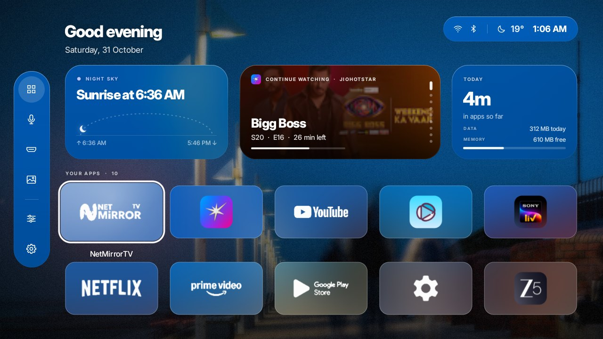</p>

Your apps as frosted tiles in one of four looks (*Glass*, *Vivid*, *Midnight* or the apps' *Original* banners), over a photograph that follows the real sun outside: night skies after dark, golden hour at dusk, and Wikimedia's *Picture of the Day* every morning. Above them, three quiet widgets:
- **Sky:** the sun's arc and the next sunrise or sunset;
- **Smart Stack:** what you're partway through, new episodes and tonight's pick;
- **Today:** time in apps, data used and free memory, turning into **Now Playing** while something plays.

Hold <kbd>OK</kbd> on an app to move it, hide it, put it in a folder or uninstall it.

### Top Shelf

<p align="center">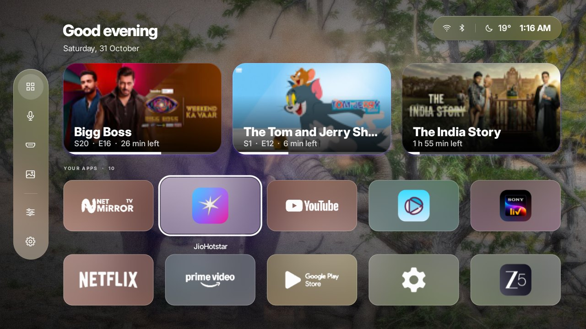</p>

Rest on an app in the top row and its shows line up above it, with how much is left: <kbd>↑</kbd> walks into them, <kbd>OK</kbd> plays.

### Recent apps, like tvOS

<p align="center">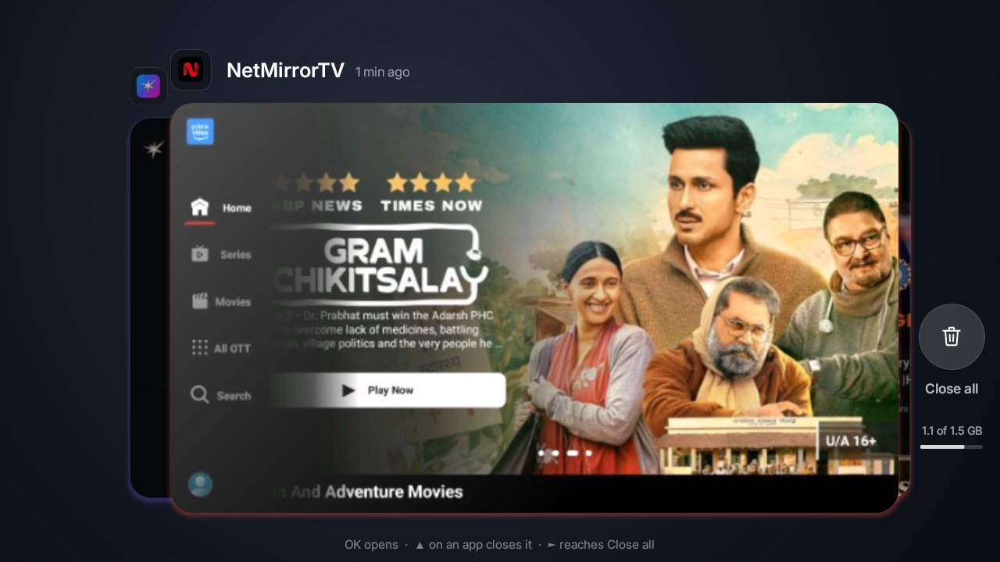</p>

Press <kbd>Home</kbd> twice. The app you're in stands large in the middle showing its last screen, older ones stack behind it on the left, and the green **● Playing now** marks whatever is playing. <kbd>▲</kbd> throws an app away (it stops for real once the TV is set up), *Close all* clears the lot and shows the memory you got back. Opening one grows its card into a launch screen, so the app's own loading never shows.

### A screensaver worth looking at

<p align="center">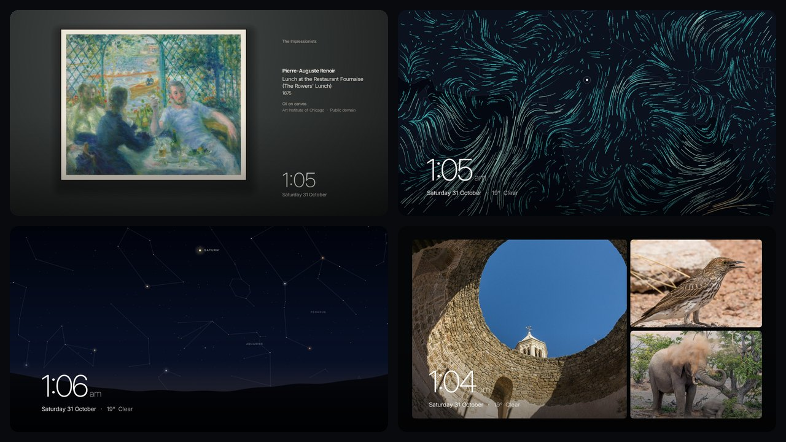</p>

| | |
|---|---|
| **Museum** | Masterpieces from the Art Institute of Chicago's open collection, each hung in a room lit for it, with a wall label. |
| **Live wind** | The real wind around you right now, as thousands of drifting trails of light. |
| **Tonight's sky** | The real sky over your city: 4,000 stars, the constellations, the Moon's real phase and the planets where they are. |
| **Earth from space** | 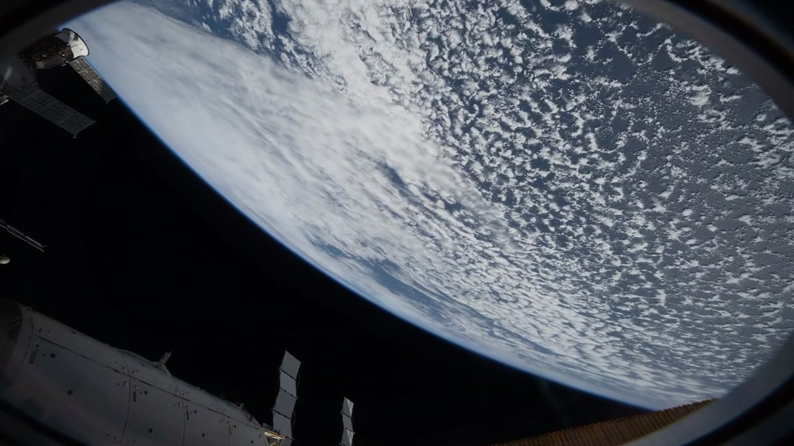<br>Time-lapses filmed from the International Space Station, downloaded over Wi-Fi, on TVs that can play them smoothly. |
| **Photo mosaic** | Photographs three at a time, yours included, turning over gently. |

<table><tr>
<td width="55%">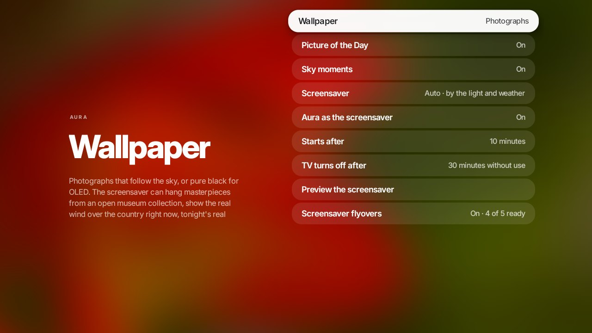</td>
<td>

**Auto** moves between them by the time of day and the weather, every quarter of an hour.

In *Settings → Wallpaper*: pick one, preview it, make Aura the TV's screensaver, and choose when it starts and when the TV turns itself off. Choosing Aura in Android's own screensaver settings opens this page too.

</td></tr></table>

### Control Center

<p align="center">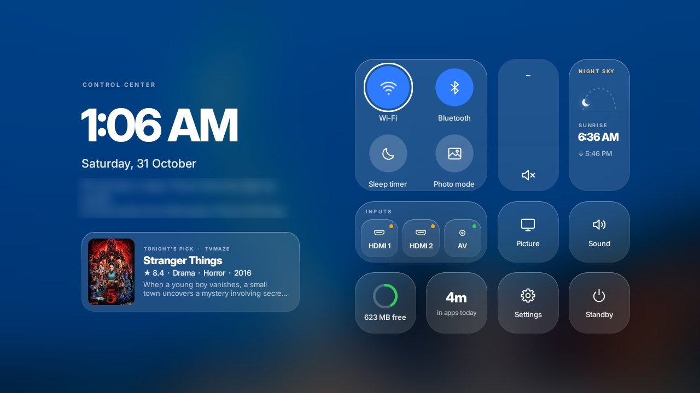</p>

<table><tr>
<td width="50%">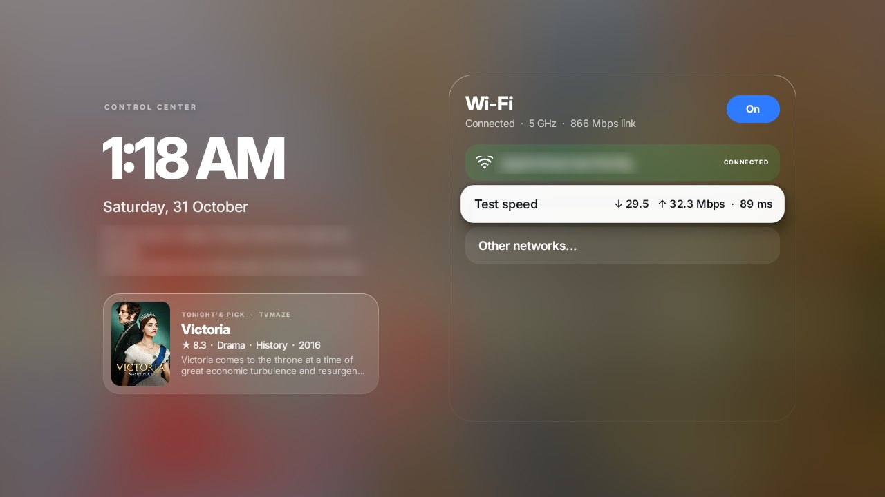</td>
<td width="50%">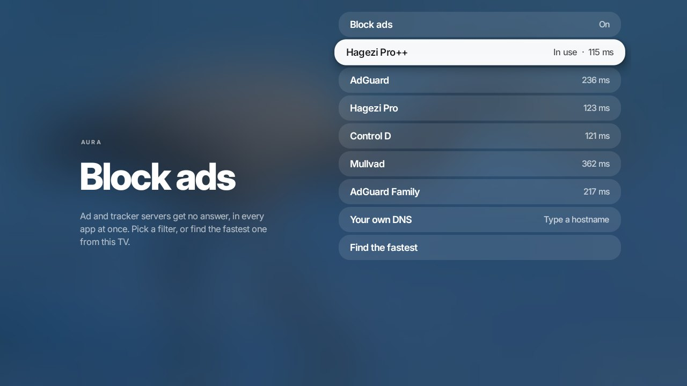</td>
</tr><tr>
<td align="center"><sub>Wi-Fi, with a speed test that stores nothing</sub></td>
<td align="center"><sub>Block ads, every filter measured from your TV</sub></td>
</tr></table>

Press <kbd>Menu</kbd>: Wi-Fi (with a speed test), Bluetooth, a sleep timer that fades the volume out, your HDMI inputs by their real names, picture and sound settings, a memory boost and standby.

### And a lot of small things

| | |
|---|---|
| **A welcome** | On first open, pick a look and your extras, each with a small preview. All of it can be changed later. |
| **Block ads** | Stops ad and tracker servers in every app at once, through Android's own Private DNS. Pick a filter, or let Aura find the fastest from your TV. |
| **From your phone** | Scan a QR code and send photos, GIFs or apps to the TV. No app, no cloud. |
| **The Home button in apps** | Home twice opens recent apps right over the app you're in; hold Home for Control Center. |
| **Remote buttons** | Give any spare button on the remote an app of your choice. |
| **Profiles** | Everyone keeps their own app order, folders, tiles and widgets. |
| **Always comes back** | If Aura ever keeps crashing, it restarts with its extras off rather than leaving you stuck. |

<p align="center">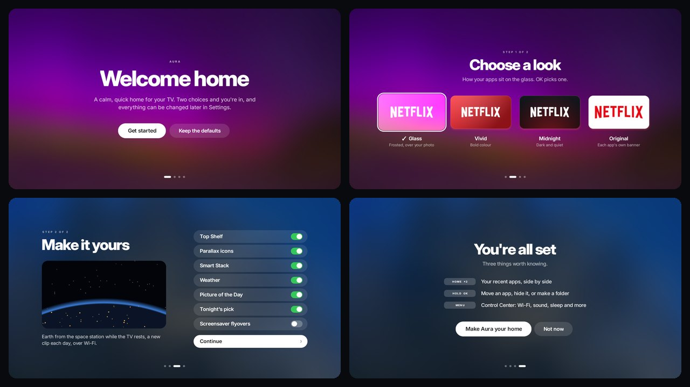</p>

<br>

## 🎮 The remote

| Press | On the home screen |
|---|---|
| <kbd>↑</kbd> <kbd>↓</kbd> <kbd>←</kbd> <kbd>→</kbd> | Move · up reaches the widgets · left reaches the sidebar |
| <kbd>OK</kbd> | Open |
| hold <kbd>OK</kbd> | Move, hide, add to folder, app info, uninstall |
| <kbd>Home</kbd> twice | Recent apps |
| <kbd>Menu</kbd> | Control Center |
| <kbd>Back</kbd> | Close whatever is open |

| Press | Inside an app (with *Home button in apps* on) |
|---|---|
| <kbd>Home</kbd> twice | Recent apps over the app |
| hold <kbd>Home</kbd> | Control Center over the app; <kbd>Back</kbd> returns to it |

<br>

## 🛟 If something isn't right

<details>
<summary><b>I installed it but can't find or open it</b></summary>
<br>

From 7.4, Aura appears in your apps like any other app and Downloader's *Open* button works. On 7.3, press <kbd>Home</kbd> and choose Aura, or update.
</details>

<details>
<summary><b>Home still opens the old launcher</b></summary>
<br>

Open Aura and choose *Settings → Home button*, or press <kbd>Home</kbd> and pick **Aura → Always**. Google TV keeps Home for its own launcher: there, *Settings → Set up on this TV → Switch everything on* makes Aura home, and *Home button in apps* lets Home bring you back to Aura from any app.
</details>

<details>
<summary><b>A black screen with sound from an HDMI tile</b></summary>
<br>

A switched-on HDMI device (a soundbar, a set-top box) shows up as the first tile. On some TVs its live picture filled the whole screen, so 7.4 turns live pictures off by default. Hold <kbd>OK</kbd> on the tile → *Hide from home*; *Settings → Hidden apps* brings it back.
</details>

<details>
<summary><b>Netflix or Prime Video show no shows above their tile</b></summary>
<br>

Top Shelf shows what each app shares with Android TV. Netflix and Prime Video share their rows only with Google's own launcher, so on any other home screen they stay empty. JioHotstar, YouTube and many others share theirs.
</details>

<details>
<summary><b>A remote button doesn't respond to Remote buttons</b></summary>
<br>

Some TVs keep certain buttons (Profile, a dedicated app button) for their own software before any app sees them. Those can't be given an app. Buttons that reach Android, like the Apps key or a colour button, can.
</details>

<details>
<summary><b>What does Aura do with my data?</b></summary>
<br>

Nothing leaves the TV except what each feature fetches: your approximate city from your connection (GeoJS, unless you type one in) and the weather (Open-Meteo), photographs and screensaver clips (Wikimedia Commons), artworks (Art Institute of Chicago), tonight's pick (TVmaze), the speed test (Cloudflare) and updates (GitHub). The switcher's pictures of your apps stay in Aura's private storage and are deleted after two days or when you close the app. No analytics, no account.
</details>

<br>

## 🔧 For tinkerers

<details>
<summary><b>Set up from a PC instead</b></summary>
<br>

On the TV turn on *Developer options* and *network debugging*, note its IP address, then on a Windows PC with `adb`:

```powershell
$env:AURA_TV = "192.168.1.50:5555"
.\tools\backup.ps1        # a snapshot first: everything can be put back from it
.\tools\setup-aura.ps1    # makes Aura home and grants what the extras need
```

`.\tools\restore.ps1 -RemoveAura` puts the TV back exactly as the snapshot recorded it.

| Script | Does |
|---|---|
| `backup.ps1` / `restore.ps1` | Snapshot of packages and settings, and putting it all back. |
| `setup-aura.ps1` | Home, screensaver, permissions, an ahead-of-time compile. |
| `tune.ps1` | Background limits and compiling. `-Undo` reverts. |
| `debloat.ps1` | A reviewed disable list for the Acer DIX41RKF Google TV. Read it before using it on another TV. |
</details>

<details>
<summary><b>Build it</b></summary>
<br>

No Gradle: `.\tools\build.ps1` drives aapt2, javac, d8, zipalign and apksigner from the Android SDK directly (Android Studio's JDK is fine). `-TestPackage` builds a copy under another package name, to test a first install beside the real one.

Plain Java on the Android framework, no AndroidX. Runs from Android 5.1; extras that need newer Android simply don't appear on older TVs. Tuned on an Acer DIX41RKF: Realtek RTD2841, Android 11, 720p, 1.5&nbsp;GB of RAM.
</details>

<details>
<summary><b>How the glass stays smooth</b></summary>
<br>

<p align="center"></p>

The photograph is blurred once, when it arrives, into a tiny copy that every pane samples, with its tint folded into one colour matrix: one draw per pane. Panels slide rather than scale text, nothing under an opaque overlay keeps drawing, and still screens draw nothing at all.

<p align="center">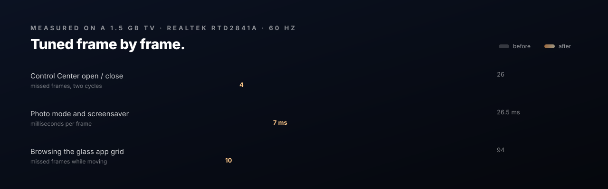</p>
</details>

<br>

## Credits

Photographs from Wikimedia Commons Featured Pictures and Picture of the Day (CC BY, CC BY-SA, CC0
and public domain), each credited on screen. Screensaver flyovers: time-lapses shot from the
International Space Station by its crews, NASA Johnson Space Center, public domain, through
Wikimedia Commons. Night sky: star positions from the XHIP Hipparcos compilation (Anderson &
Francis 2012) and constellation figures after the IAU, both via
[d3-celestial](https://github.com/ofrohn/d3-celestial) by Olaf Frohn (BSD-3-Clause); planets from
NASA JPL's approximate Keplerian elements. Museum: artworks from the Art Institute of Chicago's
open-access collection (public domain, CC0), via its public API. Live wind: weather data by
[Open-Meteo](https://open-meteo.com) (CC BY 4.0); coastlines and borders from Natural Earth (public
domain). Type: [Inter](https://rsms.me/inter/) by Rasmus Andersson, SIL Open Font License.

## License

The code is [MIT](LICENSE) © 2026 iravi. The photographs and the typeface keep their own licences.
